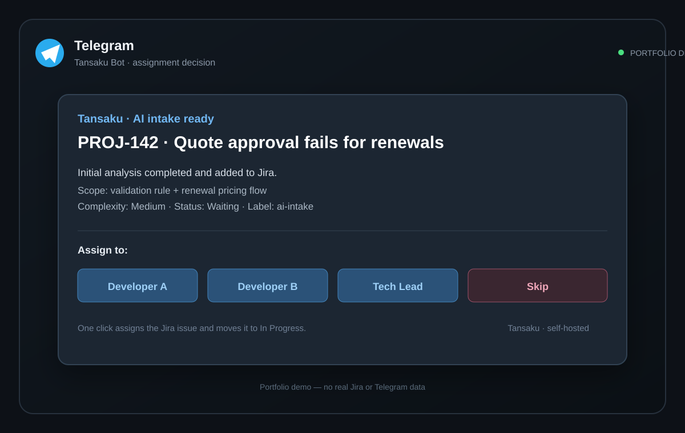

# Tansaku (探索)

**Configurable AI intake agent for Jira.** Self-hostable, works with any Jira Cloud instance. Notifies via Telegram or Slack with interactive assignment buttons.

---

## What it does

Tansaku runs on a schedule and automatically triages newly created Jira issues:

1. Fetches new issues from your Jira project
2. Searches Confluence for relevant documentation (optional)
3. Writes a technical analytical comment for the developer
4. Moves the issue to **Waiting** and marks it with an `ai-intake` label
5. Sends a notification with **inline assignment buttons** (Telegram) or **Block Kit buttons** (Slack)
6. Waits for your decision — assigns and moves to **In Progress** automatically

### The differentiator: assignment where the team already works

The analyst does the expensive context gathering, but a human still makes the ownership decision. Tansaku sends the result to Telegram with one-click assignment buttons, then applies the selected assignee and Jira transition.



The image is a safe portfolio demo with synthetic ticket and team data; it does not contain real Jira or Telegram content.

---

## Production Pilot

Tansaku ran as a production pilot at **Symfonia** (ERP/SaaS, 150+ Salesforce users) from September 21 to October 30, 2026.

**Results:**
- 269 Jira issues received automated triage analysis (comments, priority assessment, routing suggestions)
- 190 issues tagged with `ai-intake` label (precise tracker, introduced mid-pilot)
- 75 issues progressed to active development branches — full pipeline: intake → analysis → implementation
- Pilot scope: SAL project, ~40 issues/month intake volume

> The pilot concluded October 30. Numbers reflect the full 40-day run.

---

## Quickstart

```bash
# 1. Install
git clone https://github.com/pawellach/tansaku
cd tansaku
pip install -r requirements.txt && pip install -e .

# 2. Configure
cp config.example.yaml config.yaml
# Edit config.yaml — set your Jira URL, project, and API keys

# 3. Set secrets
export JIRA_API_TOKEN=your_jira_api_token
# Pick one AI provider:
export ANTHROPIC_API_KEY=sk-ant-...          # Anthropic direct
# export AWS_ACCESS_KEY_ID=...              # AWS Bedrock
# export AWS_SECRET_ACCESS_KEY=...
# export AWS_DEFAULT_REGION=us-east-1
# export OPENAI_API_KEY=sk-...             # OpenAI
export TELEGRAM_BOT_TOKEN=...   # if using Telegram
export TELEGRAM_CHAT_ID=...

# 4. Verify connections
tansaku setup

# 5. Preview (no writes to Jira)
tansaku run --dry-run

# 6. Run for real
tansaku run
```

**One-liner install:**
```bash
curl -sSL https://raw.githubusercontent.com/pawellach/tansaku/master/install.sh | bash
```

## Docker Compose

Docker is the fastest self-hosted path when Python setup should stay out of the user's way:

```bash
cp config.example.yaml config.yaml
cp team.example.json team.json
cp knowledge-base.example.json knowledge-base.json
cp .env.example .env  # or create .env with the variables below

docker compose build
docker compose --profile setup run --rm setup
docker compose run --rm tansaku
```

The default `tansaku` service is a one-shot run. Schedule it with the host's cron, a CI scheduler, or an orchestrator. Secrets are read from `.env` and the local configuration files are mounted read-only into the container.

For Windows/Docker Desktop, use the checked-in PowerShell helper:

```powershell
Copy-Item .env.example .env
# Edit .env, config.yaml, team.json, and knowledge-base.json first
.\scripts\docker-tansaku.ps1 -StartDockerDesktop -Build -Setup
.\scripts\docker-tansaku.ps1 -DryRun
```

---

## AI Providers

Tansaku works with any of the following AI providers — set `ai.provider` in `config.yaml`:

| Provider | Config key | Env vars needed | Example model |
|---|---|---|---|
| **Anthropic** (direct) | `provider: anthropic` | `ANTHROPIC_API_KEY` | `claude-opus-4-5-20251101` |
| **AWS Bedrock** | `provider: bedrock` | `AWS_ACCESS_KEY_ID` + `AWS_SECRET_ACCESS_KEY` + `AWS_DEFAULT_REGION` | `anthropic.claude-opus-4-5-20251101` |
| **OpenAI** | `provider: openai` | `OPENAI_API_KEY` | `gpt-4o` |

> **Bedrock tip:** on EC2/ECS/Lambda with an IAM role, omit `aws_access_key` and `aws_secret_key` — credentials are picked up automatically from the instance role.
>
> **OpenAI:** install the extra package first: `pip install openai`

---

## Commands

| Command | Description |
|---|---|
| `tansaku run` | Daily batch intake (last N hours of new issues) |
| `tansaku run --dry-run` | Preview without writing to Jira |
| `tansaku run --ticket PROJ-123` | Process a single ticket |
| `tansaku test PROJ-123` | Dry-run for one ticket |
| `tansaku setup` | Verify Jira, AI provider, and notification connections |

---

## Configuration

Copy `config.example.yaml` to `config.yaml` and edit:

```yaml
jira:
  base_url: "https://yourcompany.atlassian.net"
  email: "you@company.com"
  api_token: "${JIRA_API_TOKEN}"   # from env var
  project: "PROJ"

anthropic:
  api_key: "${ANTHROPIC_API_KEY}"
  model: "claude-opus-4-5-20251101"

notification:
  channel: "telegram"   # "telegram", "slack", or "none"
  telegram:
    bot_token: "${TELEGRAM_BOT_TOKEN}"
    chat_id: "${TELEGRAM_CHAT_ID}"

intake:
  auto_close_days: 5
  max_batch: 5
  label: "ai-intake"
  transitions:
    waiting: "41"       # ← check your Jira project's transition IDs
    in_progress: "21"
    rejected: "61"
  language: "en"        # "en" or "pl"
```

---

## Getting Jira transition IDs

Run this once to list available transitions for an issue:
```bash
python -c "
from tansaku.config import load_config
from tansaku.jira_client import JiraClient
cfg = load_config()
j = JiraClient(**{k: cfg['jira'][k] for k in ['base_url','email','api_token']})
print(j.get_transitions('PROJ-1'))
"
```

---

## Telegram setup

1. Create a bot: message [@BotFather](https://t.me/BotFather) → `/newbot`
2. Copy the bot token → `TELEGRAM_BOT_TOKEN`
3. Get your chat ID: message [@userinfobot](https://t.me/userinfobot) → copy the ID → `TELEGRAM_CHAT_ID`
4. Start a conversation with your bot (send `/start`)

For end-to-end assignment, each member in `team.json` must provide either `jira_account_id`, `account_id`, or an exact Jira user email/name. When a button is selected, Tansaku resolves the account, assigns the Jira issue, transitions it to `In Progress`, and sends confirmation only after both Jira operations succeed.

---

## GitHub Actions (optional)

The repo includes `.github/workflows/intake.yml` for scheduled cloud runs.

```
Settings → Secrets → New repository secret:
  JIRA_API_TOKEN
  ANTHROPIC_API_KEY
  TELEGRAM_BOT_TOKEN
  TELEGRAM_CHAT_ID
```

The workflow runs Mon–Fri every 2h during business hours (UTC). Manual trigger available with `dry_run` and `ticket` inputs.

---

## Optional: knowledge base

Copy `knowledge-base.example.json` to `knowledge-base.json` and add project-specific rules:
- Facts (environment, reporter types, issue conventions)
- Questions to never ask
- Fix strategy thresholds
- Module → assignee patterns

---

## Architecture

See [docs/architecture.md](docs/architecture.md).

The product roadmap covers the three-surface knowledge model, specialist delivery agents, UAT handoffs, and Docker operations: [ROADMAP.md](ROADMAP.md).

---

## Writing

Articles related to this project:

**English (Medium):**
- [AI Agents Are Learning to Decide. Literally.](https://medium.com/@pawellach/ai-agents-are-learning-to-decide-literally-f07923a4c85e) — the decision architecture behind tansaku

**Polish (Substack):**
- Search [pawellach.substack.com](https://pawellach.substack.com) for "intake" or "triage" for related Polish-language posts

---

## Author

Built by [Paweł Lach](https://pawellach.github.io) — PM and AI practitioner with 15+ years in digital transformation. This tool solves a real problem from my daily work managing a 40+ issue/month Salesforce delivery backlog.

---

## License

MIT
